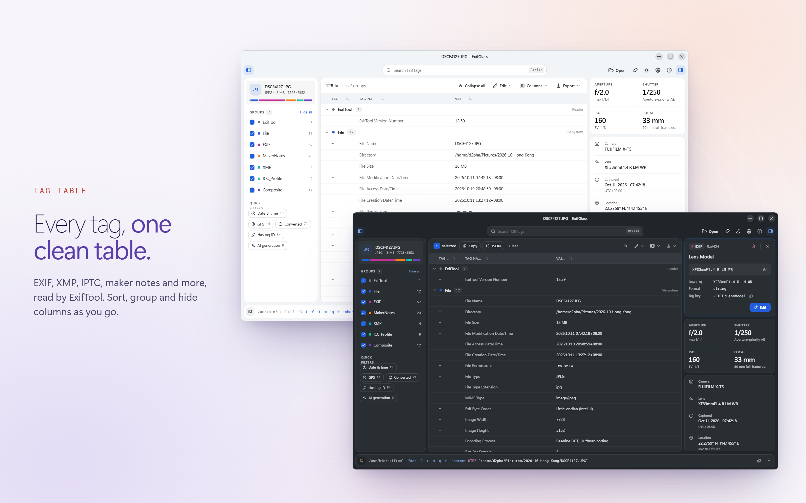

ExifGlass - AI & EXIF metadata viewer
===

ExifGlass shows the metadata inside your images, AI generations first. Open a picture made with Stable Diffusion, ComfyUI, InvokeAI, NovelAI, Fooocus, Midjourney and many more, and ExifGlass shows its prompt, negative prompt, models, LoRAs, sampler settings and seed, a summary of its workflow, and the provenance it carries. Every other tag ExifTool reads sits in one searchable table: camera settings, lens, exposure, GPS location, timestamps and more.

ExifGlass works on its own or beside [ImageGlass](https://imageglass.org), where it follows the photo you browse. It runs on Windows, macOS and Linux, and comes with [ExifTool by Phil Harvey](https://exiftool.org) built in, so there is nothing else to install.

ExifGlass is free and open source. To support its development and get updates through the store, consider buying it from the [Microsoft Store](https://apps.microsoft.com/detail/9MX8S9HZ57W8?launch=true&cid=github_readme&mode=full).

 

## Features

### AI generation data
- The prompt, negative prompt, models, LoRAs and embeddings, sampler, scheduler, steps, CFG, seed and size, read from AUTOMATIC1111 and Forge, ComfyUI, InvokeAI, NovelAI, Fooocus, SwarmUI, Draw Things, Easy Diffusion, Tensor.Art and Midjourney files.
- ComfyUI workflows summarised (nodes, samplers, models) and saved as a `.json` file that loads back into ComfyUI.
- Provenance: C2PA Content Credentials (shown as not verified, because ExifGlass checks no signature), the IPTC digital source type, AI labels and AI-training signals.
- An "AI generation" group at the top of the table, each field linked to the tag it was read from.
- Copy the generation parameters as AUTOMATIC1111 text, or export them as text or JSON.

### Every tag
- One table for every tag ExifTool reads, grouped, with tag IDs: search, sort, hide groups, and quick filters for dates and times, GPS, converted values, prompts, models and provenance.
- An inspector for the selected tag, with the preview, the exposure, and the camera, lens, time and place.
- Copy a value, a row or a selection; export the rows in view as CSV, plain text or ExifTool-style JSON.

### Editing
- Edit, add and delete tags; remove the GPS data or the AI generation data before you share a file, or strip all metadata. Changes wait until you save, and ExifTool keeps the original file as a backup.
- The command bar shows the exact ExifTool command for the read, or for the save while changes wait, ready to copy.

### Private by design
- Everything stays on your computer: prompts and metadata are never sent anywhere, and nothing is looked up online. The only network request is the update check, which you can turn off (see [PRIVACY.md](PRIVACY.md)).

## Keyboard

| Keys | Action |
| -- | -- |
| <kbd>Ctrl/Cmd</kbd> + <kbd>O</kbd> | Open a file (or drop one on the window) |
| <kbd>Ctrl/Cmd</kbd> + <kbd>K</kbd> | Search tags |
| <kbd>Ctrl/Cmd</kbd> + <kbd>A</kbd>, <kbd>Ctrl/Cmd</kbd> + <kbd>C</kbd> | Select every row in view, copy the selection |
| <kbd>Ctrl/Cmd</kbd> + <kbd>,</kbd> | Settings |
| <kbd>F1</kbd> | About |
| <kbd>Esc</kbd> | Step back: cancel an edit, close a menu or panel, clear the search, then the selection, then close the window |

## Use ExifGlass with ImageGlass
ExifGlass follows the photo ImageGlass shows: as you browse in ImageGlass, the metadata table, the AI card and the inspector follow each photo. It works with ImageGlass 10 on Windows, macOS and Linux, and with ImageGlass 9 on Windows. The Mac App Store version can't connect to ImageGlass, because the App Sandbox doesn't allow it.

### ImageGlass 10
ImageGlass 10 comes with an ExifGlass tool already set up (ID `Tool_ExifGlass`, hotkey <kbd>X</kbd>). Press <kbd>X</kbd> to open ExifGlass beside the photo; it closes when ImageGlass closes. If the tool was removed, or ExifGlass is installed somewhere else, open Settings > Tools in ImageGlass, click "Add" and fill in:

| | Windows | macOS | Linux (Flatpak) | Linux (AppImage) |
| -- | -- | -- | -- | -- |
| ID | `Tool_ExifGlass` | `Tool_ExifGlass` | `Tool_ExifGlass` | `Tool_ExifGlass` |
| Integrated with ImageGlass.SDK | checked | checked | checked | checked |
| Executable | `exifglass` (the Store and MSIX versions add it to PATH; for the ZIP, the full path of `ExifGlass.exe`) | `/Applications/ExifGlass.app` | `flatpak` | the full path of the `.AppImage` file |
| Argument | `<file>` | `<file>` | `run io.github.d2phap.exifglass <file>` | `<file>` |
| Hotkey | <kbd>X</kbd> | <kbd>X</kbd> | <kbd>X</kbd> | <kbd>X</kbd> |

ImageGlass must start ExifGlass itself: a script or launcher in front of it breaks the connection on Windows.

> [!NOTE]
> If ImageGlass closes while ExifGlass has unsaved changes, ExifGlass keeps them and offers to restore them the next time it starts.

### ImageGlass 9 (Windows)
Add ExifGlass as an integrated tool, as [ImageGlass Docs / ImageGlass tools](https://imageglass.org/docs/imageglass-tools#add-your-tool-to-imageglass) describes: the executable is `ExifGlass.exe` (or `exifglass`) and the argument `<file>`. ExifGlass closes when you turn the tool off or close ImageGlass.

## License
ExifGlass is released under the terms of [GPLv3](https://github.com/d2phap/ExifGlass/blob/main/LICENSE). The store versions are paid builds of the same code that support its development.
